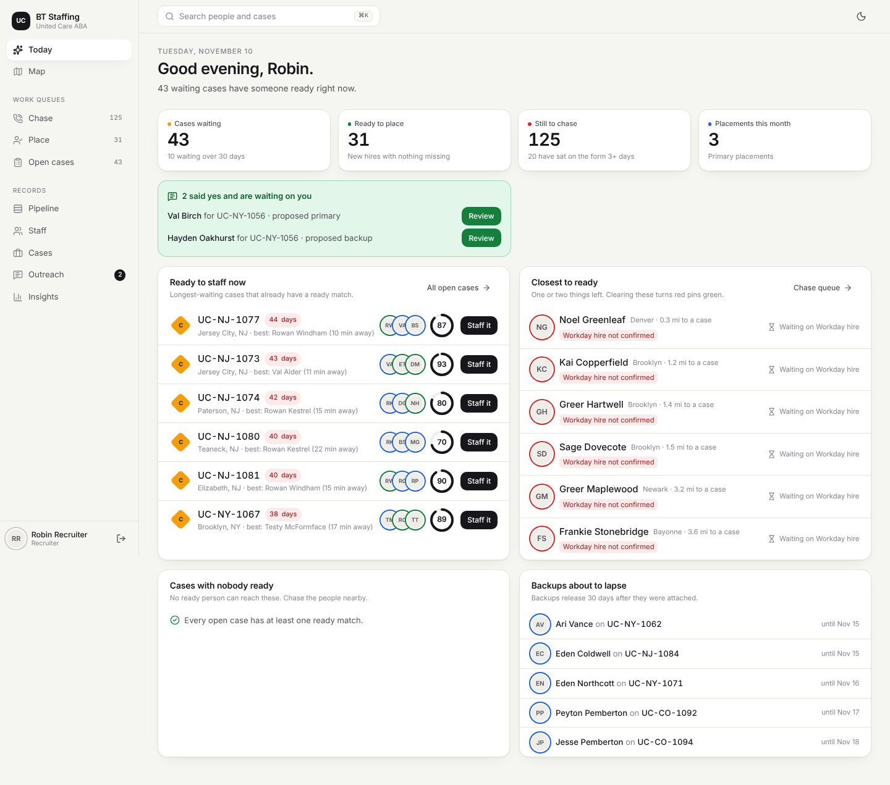
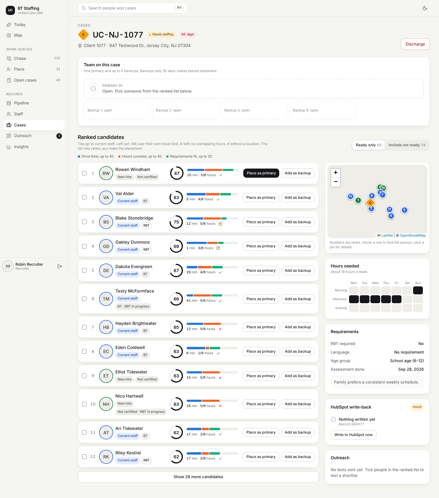
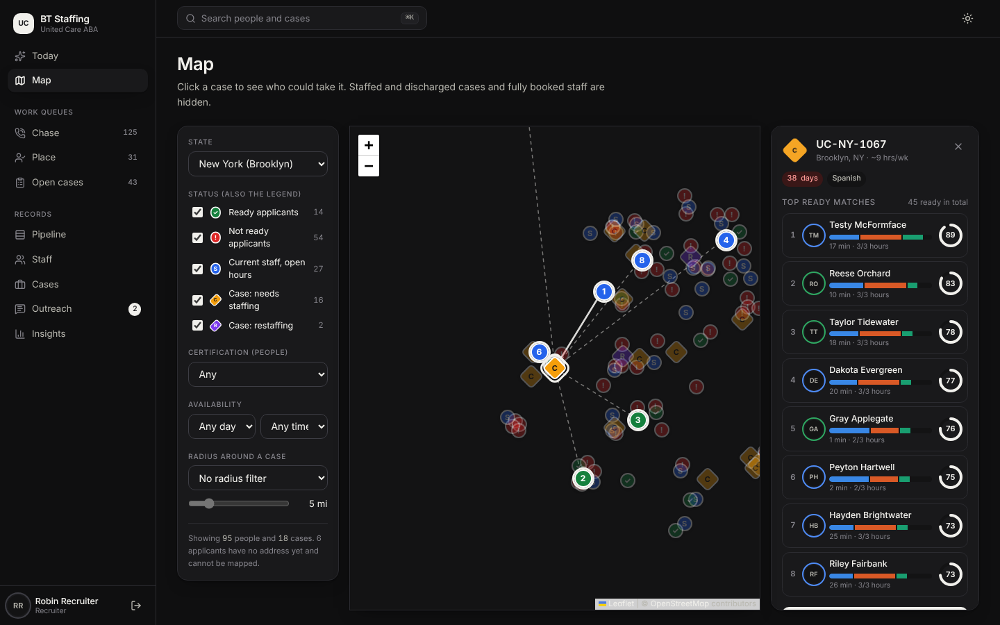
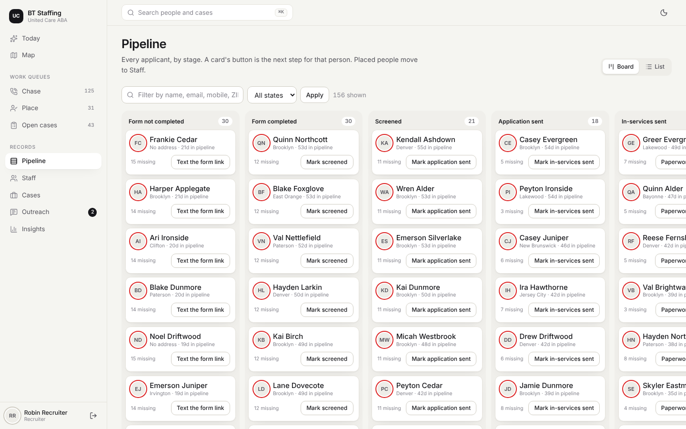
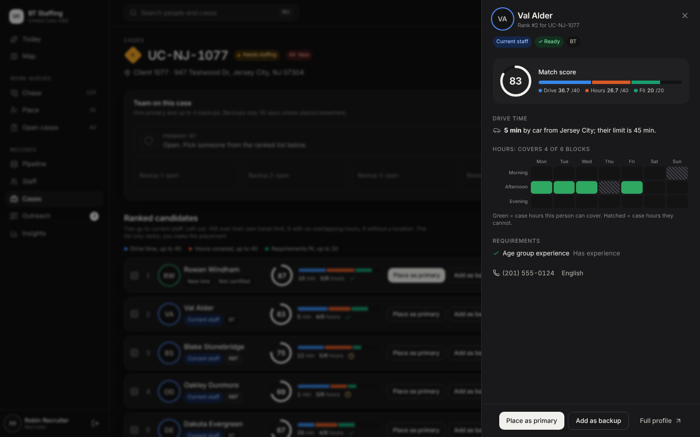
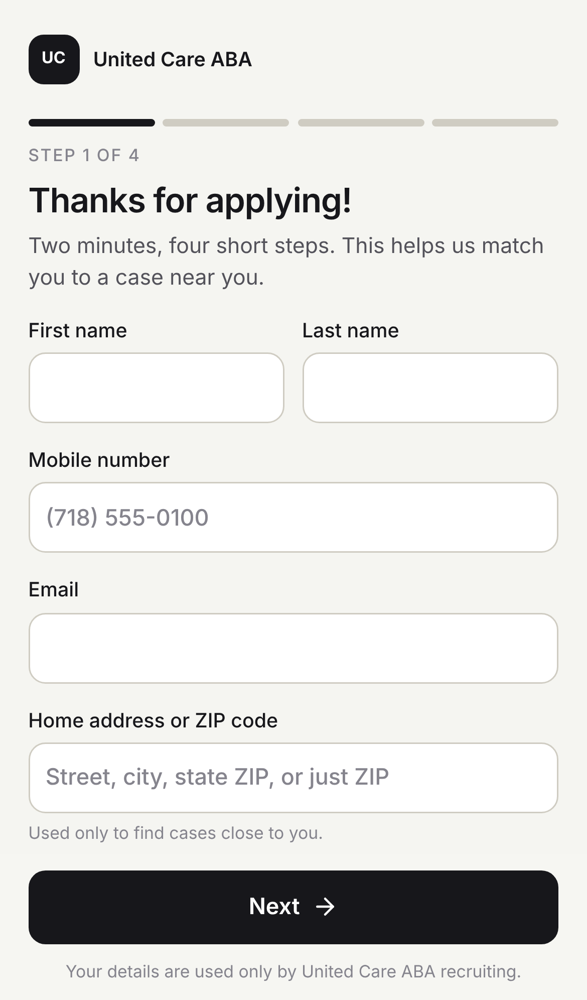

# United Care ABA - BT Staffing

Gets behavior technicians (BT / RBT) from "applied" to "placed on a case" faster.
In-home ABA cases in NY, NJ and CO finish their initial assessment and then wait
for a BT; this app shows who is closest to ready, who is ready, and which case
each person fits best. **The system only ranks. A recruiter makes every placement by hand.**

Stack: Next.js 15 (App Router, TypeScript), PostgreSQL + Prisma, Tailwind,
Leaflet with OpenStreetMap tiles.

## Run it locally

### Option A: Docker Compose (nothing else to install)

```bash
cd bt-staffing
docker compose up --build
```

Open http://localhost:3000. The first start applies the database migrations
and loads the fake demo data.

### Option B: Node on your machine

Needs Node 22 and a PostgreSQL 16 database.

```bash
cd bt-staffing
cp .env.example .env          # edit DATABASE_URL if your Postgres differs
npm install
npx prisma migrate deploy     # create the tables
npm run db:seed               # load fake demo data (wipes existing rows)
npm run dev                   # http://localhost:3000
```

## Demo logins

| Role | Email | Password | Can do |
|---|---|---|---|
| Recruiter | `recruiter@example.com` | `Recruiter123!` | Pipeline, placements, outreach, case status |
| Recruiter (second, so the dashboard has two) | `recruiter2@example.com` | `Recruiter123!` | Same |
| Offshore recruiter | `offshore@example.com` | `Offshore123!` | Pipeline only: screening, paperwork, notes. Cannot place, text shortlists or change case status |
| Admin | `admin@example.com` | `Admin123!` | Everything, plus Integrations and Users |

Role rules live in one file: `src/lib/permissions.ts`.
**Change or delete these accounts before real use.** There is no user-management
screen yet; users are created by the seed script. The login page shows one-click
buttons for the demo accounts unless `SHOW_DEMO_LOGINS=false`.

The public applicant form is at `/apply` (no login).

## What is where

| Screen | Path | What it does |
|---|---|---|
| Today | `/today` | The home screen. Replies waiting to be confirmed, the longest-waiting cases that already have a ready match, the people one or two steps from ready (with a one-click next step), cases nobody ready can reach, backups about to lapse |
| Map | `/map` | Green = ready, red = not ready, blue = current staff with open hours, diamonds = cases needing staffing / restaffing. Filters: state, status, certification, availability, radius around a case. Click a case to draw its top ready matches as ranked pins and lines |
| Chase queue | `/queues/chase` | Not-ready people sorted by distance to the nearest open case (or by fewest missing), with what is missing and a one-click next step |
| Place queue | `/queues/place` | Ready people with their top matching cases |
| Open cases | `/queues/open-cases` | Days waiting and number of ready matches |
| Pipeline | `/applicants` | Board with one column per stage (default) or a searchable list. Each card's button is that person's next step |
| Staff / Cases | `/staff`, `/cases` | Lists with filters |
| Person | `/people/[id]` | Ready / Not ready with missing items, journey with inline step buttons and the paperwork checklist, best open cases, texts, notes |
| Case | `/cases/[id]` | The matching workspace: team slots (1 primary + 4 backups), ranked candidates with score breakdown, a live mini-map, a detail drawer per candidate, shortlist texting, HubSpot write-back status |
| Outreach | `/outreach` | Texts sent to shortlists, replies, confirm primary / backups |
| Insights | `/dashboard` | Cases waiting and days waiting, applicants by stage, placements per recruiter per month, time from applied to placed |
| Integrations (admin) | `/integrations` | Mock/live status, run a sync, simulate Workday "hired", mock HubSpot records, integration log |
| Applicant form | `/apply` | Public, mobile first, four short steps; keeps a draft on the phone until it is sent |

Around every screen: search for any person or case from the top bar (Ctrl/Cmd+K),
light and dark themes (follows the device, with a toggle), and a bottom tab bar on phones.
Colour always means the same thing: green ready, red not ready, blue current staff,
amber case needing staffing, violet restaffing.

## How it works

### How people enter

1. Applicant applies on Apploi; Apploi syncs the record to HubSpot.
2. The sync (`POST /api/cron/sync`, or "Run sync" on the Integrations screen)
   reads applicant contacts from HubSpot and creates a profile at stage
   "Applied", shown as **Form not completed**. It also texts the form link
   through the Salesmsg adapter (turn off with `SEND_FORM_LINK_ON_INTAKE=false`
   if a Salesmsg automation already sends that text).
3. Submitting `/apply` creates the profile, or updates the one matched on
   **mobile first, then email**.

The intake source is an interface (`src/lib/intake/types.ts`). Today's
implementation is `ApploiHubSpotIntakeSource`; a career page would implement
the same interface (or call `ingestApplicant()` directly) and nothing downstream changes.

### Pipeline and readiness (`src/lib/readiness.ts`)

Applied > Form completed > Screened > Application sent > In-services sent >
Paperwork complete > Ready to place > Placed.

The stage is derived from what has actually happened, in order, stopping at the
first gap. A person is **Ready** when nothing is missing:
form completed, screened, application sent, in-services sent, every paperwork
checklist item ticked, availability on file, address located on the map, and
the Workday "hired" event received (`REQUIRE_WORKDAY_HIRE=false` drops that last rule).
The checklist items are a starting guess; edit `CHECKLIST_ITEMS` in `src/lib/constants.ts`.

When a recruiter places an applicant as primary, the person becomes current staff.

### Matching (`src/lib/matching.ts`)

For each open case, every candidate gets a score out of 100:

| Part | Max | How |
|---|---|---|
| Drive time | 40 | 0 minutes = 40, 60+ minutes = 0 |
| Availability | 40 | Share of the case's hours the person's open hours cover |
| Requirements | 20 | Share of the case's requirements met (RBT required, language, age-group experience) |

Hard rules: a candidate is left out if the drive is over **their own** max
travel time, if they have no overlapping hours, or if they have no location.
Unmet requirements lower the score and are flagged in red; they do not hide the
person, because the recruiter decides. At equal score, current staff with open
hours rank ahead of new hires, then the shorter drive wins.
Staff are matched on their remaining open hours (availability minus the hours of
the cases they are primary on).

### Assignment

One primary and up to 4 backups per case. Backups expire after 30 days, or
sooner if the person is placed as primary anywhere. Moving a case to
restaffing removes the primary and shows the backups first. Only a ready
person can be primary.

### Outreach

On a case, tick people in the ranked list and send the "case starting near
you" text. Replies are logged. The first YES is **proposed** as primary and later
YESes as backups; a recruiter clicks Confirm to make it real (this keeps the
"recruiter makes every placement" rule). In mock mode, simulate replies on the
outreach screen.

### Integrations

Each system sits behind an adapter interface in `src/lib/integrations/`.

| System | Mode switch | Today |
|---|---|---|
| HubSpot | `HUBSPOT_MODE=mock\|live` | Mock (default) **and** a live adapter using the CRM v3 API with a private app token |
| Apploi | `APPLOI_MODE` | Mock only |
| Salesmsg | `SALESMSG_MODE` | Mock only |
| Workday | `WORKDAY_MODE` | Mock only (webhook endpoint is real) |

HubSpot write-back: whenever a primary or backup changes, the case record in
HubSpot is updated with status, primary name / phone / email, the backup list
and the staffed date. A failed write never undoes a placement: it is recorded on
the case and in the integration log, and can be retried from the case screen.

Endpoints for other systems:

| Endpoint | Auth | Purpose |
|---|---|---|
| `POST /api/webhooks/workday` | header `x-webhook-secret` | `{ "event": "hired", "employeeId": "...", "email": "...", "mobile": "...", "hireDate": "2026-01-15" }` |
| `POST /api/webhooks/salesmsg` | header `x-webhook-secret` | `{ "from": "+17185550101", "body": "YES" }` |
| `POST /api/cron/sync` | `Authorization: Bearer <CRON_SECRET>` | Pull applicants + cases, expire old backups |
| `GET /api/health` | none | Database check |

### Geo

`Geocoder` (`src/lib/geo/geocoder.ts`) and `DriveTimeProvider`
(`src/lib/geo/drivetime.ts`) are interfaces. Today: a mock geocoder that knows
the seeded ZIP codes, and a straight-line estimate (distance x 1.3 at 22 mph by
car, 11 mph without a car).

## Tests

```bash
npm test
```

- `tests/matching.test.ts`: hard rules, score breakdown, staff-first tie break
- `tests/readiness.test.ts`: pipeline stages and Ready / Not ready rules
- `tests/nextstep.test.ts`: the "next step" shown on cards and queues
- `tests/hubspot-writeback.test.ts`: payload, mock adapter, live adapter against
  a fake `fetch`, and an end-to-end run (placement > mock HubSpot record) against
  a real Postgres. The end-to-end part needs `DATABASE_URL_TEST` (a separate,
  empty database) and is skipped without it.

## Seed data

All fake: random first/last name combinations, `example.com` emails, 555-01xx
phone numbers, invented street names. 150 applicants, 80 staff, 40 open cases
(33 needs staffing, 7 restaffing) across Brooklyn, New Jersey and Denver, plus
60 staffed / discharged cases so that current staff have caseloads. The mock
HubSpot also holds 6 contacts and 3 cases that have not been imported, so
"Run sync" visibly does something.

## Stubbed, real, and what you need to supply

See [DEPLOY.md](./DEPLOY.md) for the Azure steps and the full go-live list.

## Screenshots

| | |
|---|---|
| Today  | Matching workspace  |
| Map with a case selected (dark)  | Pipeline board  |
| Candidate drawer (dark)  | Applicant form  |

Map tiles are blank in these captures because the machine that took them could
not reach OpenStreetMap; they load normally in a browser.
